<p align="center">
  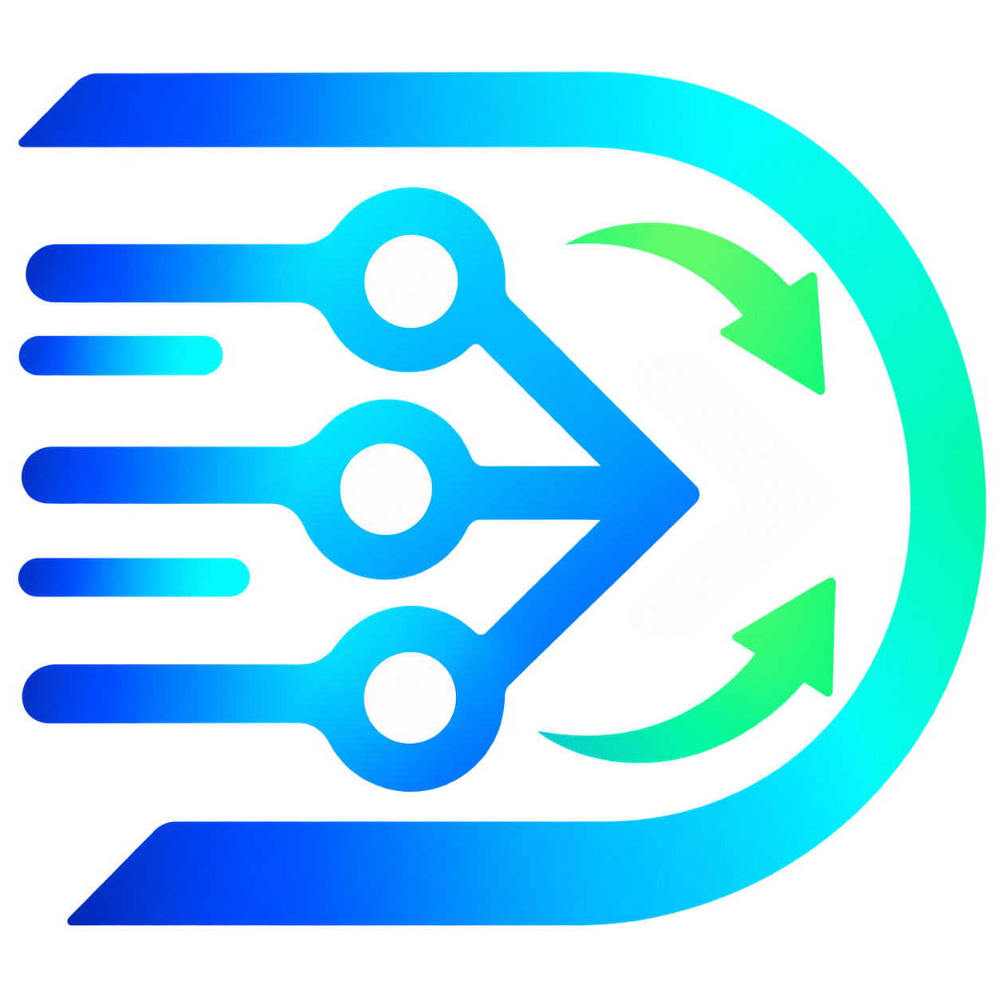
</p>

<h1 align="center">DevBoost</h1>

<p align="center">A dashboard for macOS and IOS, for remote development servers. Quickly helping you stay organized and your services to be observed. </p>

## Features

### Overview

One home screen per server summarizes forwards, Docker, folder syncs, services, and AI usage, on the desktop dashboard and the iOS app.

<table align="center">
  <tr>
    <th>Desktop</th>
    <th>Mobile</th>
  </tr>
  <tr>
    <td><a href="assets/screenshots/desktop-home.png">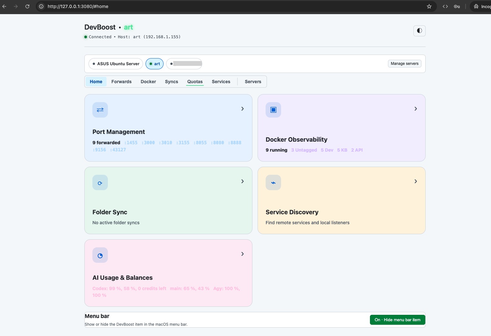</a></td>
    <td><a href="assets/screenshots/mobile-home.png">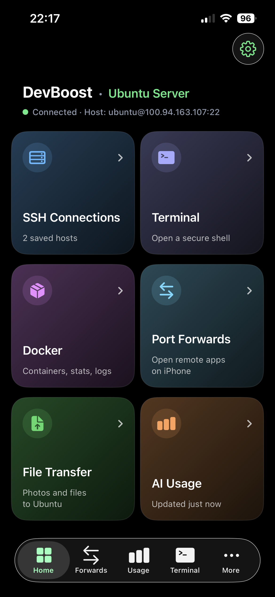</a></td>
  </tr>
</table>

### Port forwards

Forward remote ports over SSH for one session (`Once`) or keep them alive automatically with `launchd` (`Auto`), and open forwarded apps from your Mac or iPhone.

<table align="center">
  <tr>
    <th>Desktop</th>
    <th>Mobile</th>
  </tr>
  <tr>
    <td><a href="assets/screenshots/desktop-forwards.png">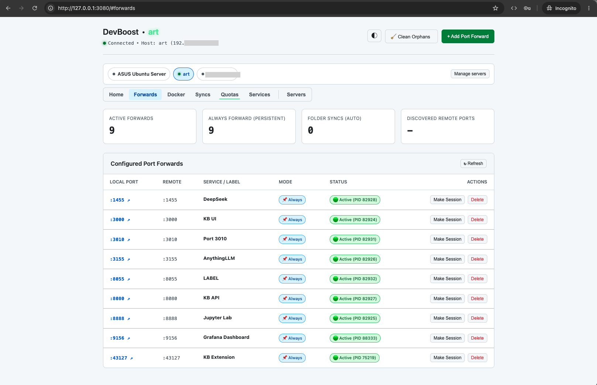</a></td>
    <td><a href="assets/screenshots/mobile-forwards.png">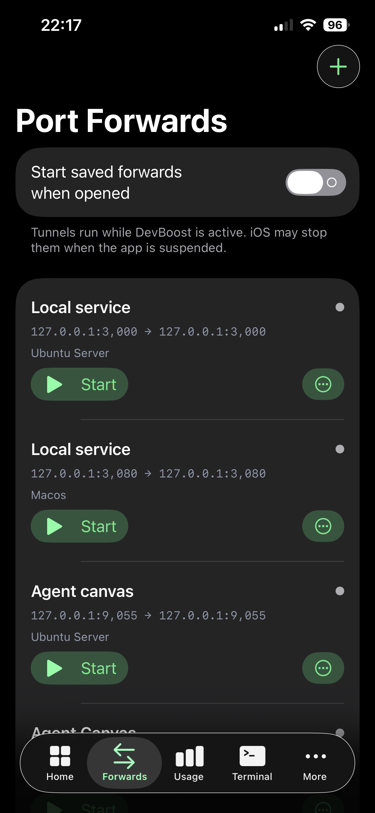</a></td>
  </tr>
</table>

### Service discovery

DevBoost scans the remote host for listening services and local listeners so you can forward any of them with one click.

<table align="center">
  <tr>
    <th>Desktop</th>
  </tr>
  <tr>
    <td><a href="assets/screenshots/desktop-service-discovery.png">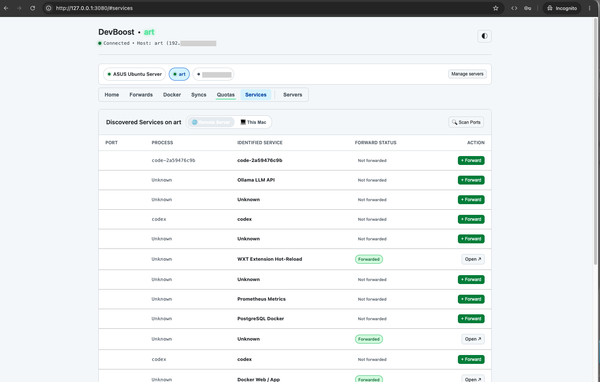</a></td>
  </tr>
</table>

### Docker

DevBoost finds the Docker containers running on the target server, lists them with their stats and disk usage, and lets you open each container's live logs.

<table align="center">
  <tr>
    <th>Desktop</th>
    <th>Mobile</th>
  </tr>
  <tr>
    <td><a href="assets/screenshots/desktop-docker.png">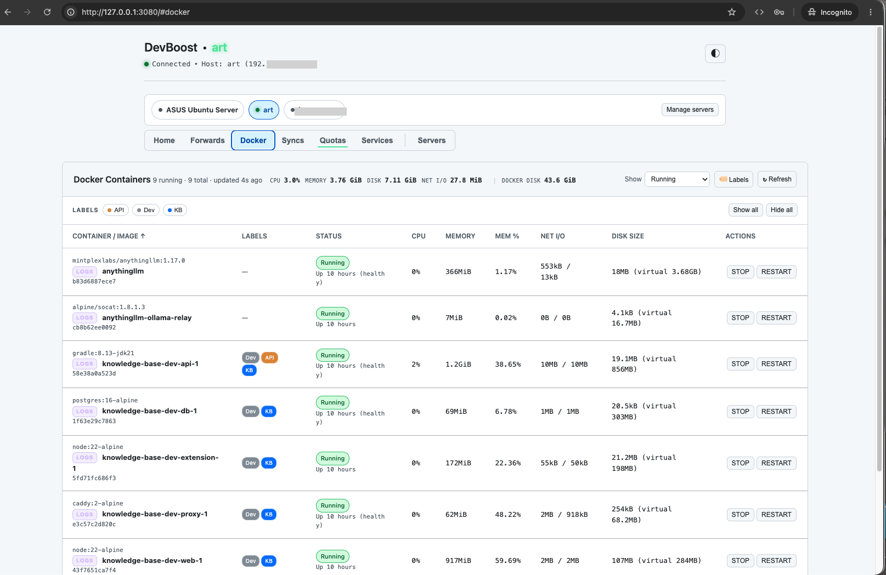</a></td>
    <td><a href="assets/screenshots/mobile-docker.png">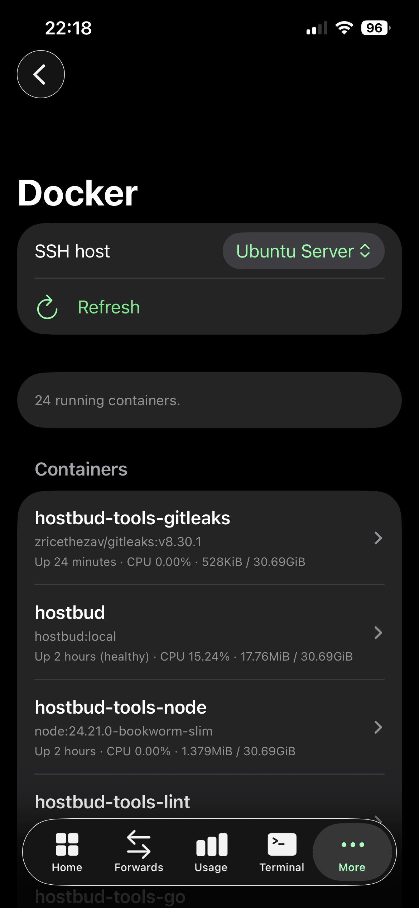</a></td>
  </tr>
</table>

### Folder sync and file transfer

Sync folders over SSH with safe two-way merging or one-way mirroring from the desktop, and upload files, photos, or videos to the server from your phone.

<table align="center">
  <tr>
    <th>Desktop</th>
    <th>Mobile</th>
  </tr>
  <tr>
    <td><a href="assets/screenshots/desktop-folder-syncs.png">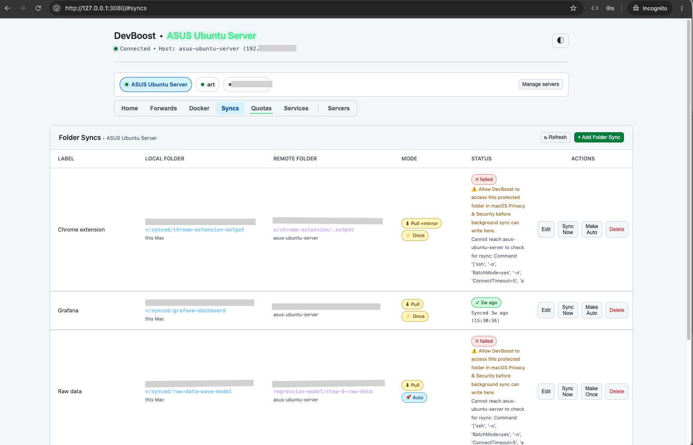</a></td>
    <td><a href="assets/screenshots/mobile-sftp.png">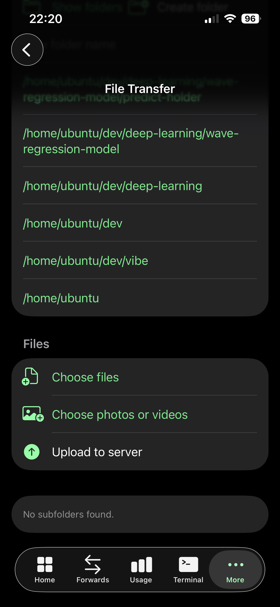</a></td>
  </tr>
</table>

### AI usage

Track usage windows, limits, and balances for supported AI provider accounts on each machine.

<table align="center">
  <tr>
    <th>Desktop</th>
    <th>Mobile</th>
  </tr>
  <tr>
    <td><a href="assets/screenshots/desktop-usages.png">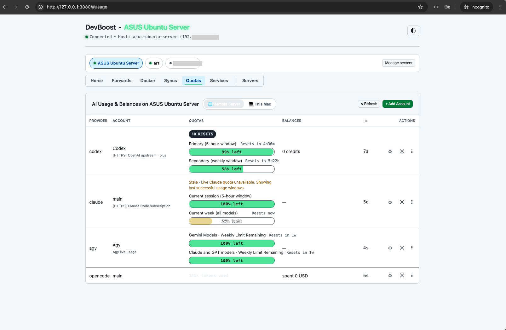</a></td>
    <td><a href="assets/screenshots/mobile-usage.png">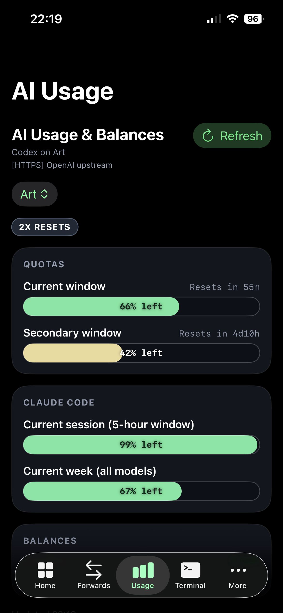</a></td>
  </tr>
</table>

### Menu bar and Live Activities

Keep an eye on usage without opening the dashboard: from the macOS menu bar item or an iOS Live Activity on the lock screen.

<table align="center">
  <tr>
    <th>macOS menu bar</th>
    <th>iOS Live Activity</th>
  </tr>
  <tr>
    <td><a href="assets/screenshots/menubar-item.png">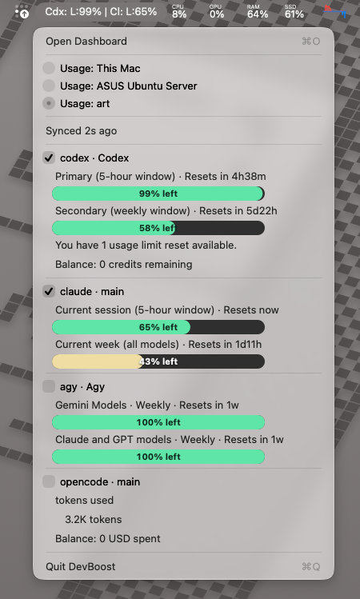</a></td>
    <td><a href="assets/screenshots/mobile-live-activities.png">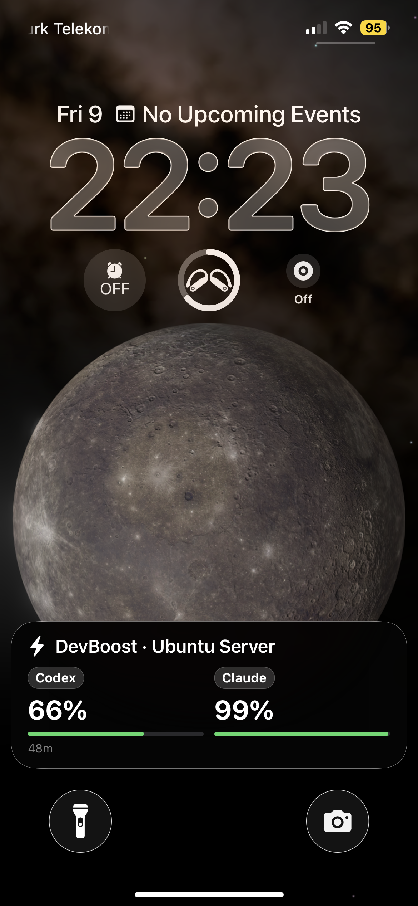</a></td>
  </tr>
</table>

### Server management

Add, connect, reorder, and switch between servers; the selected server drives forwards, Docker, syncs, services, and usage.

<table align="center">
  <tr>
    <th>Desktop</th>
  </tr>
  <tr>
    <td><a href="assets/screenshots/desktop-server-setup.png">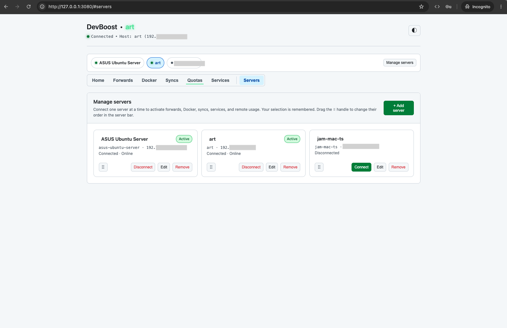</a></td>
  </tr>
</table>

## How to run

Requirements: macOS, Python 3, SSH access to at least one development server, and
`rsync` for folder sync.

From a checkout:

```bash
./run-app.sh
```

This builds and launches the menu-bar app and dashboard at
<http://localhost:3080>. Use `./run-app.sh --foreground` to keep app output in
the terminal. Configure servers in the dashboard, or set the initial server in
the per-user `.env` file before the first launch. Runtime state is kept outside
the repository.

## Using DevBoost

The dashboard shows active forwards, remote services, Docker data, folder syncs,
and usage accounts. Common CLI commands are:

```bash
devboost                 # list forwards
devboost add 8080        # forward remote port 8080 for this session
devboost add 3030 --always "Grafana"
devboost scan            # find listening remote services
devboost sync            # list folder syncs
devboost docker          # show remote containers
devboost usage --refresh # refresh provider usage
devboost clean           # clean orphaned SSH forwards
devboost ui              # open the dashboard
```

Forwards and syncs can be changed between temporary (`Once`) and persistent
(`Auto`) operation. Two-way sync is always a safe merge: newer files win and
deletions never propagate. `mirror --delete` is available only for one-way sync.

## Development

DevBoost is a standard-library-only Python project. The main compatibility entry
point is [`devboost.py`](devboost.py); the dashboard assets live in `dashboard/`.

Run checks before contributing:

```bash
python3 -W error::SyntaxWarning -m py_compile devboost.py
python3 -m unittest discover tests -v
xcodebuild test -project ios/DevBoost/DevBoost.xcodeproj -scheme DevBoost \
  -destination 'platform=iOS Simulator,name=iPhone 17' CODE_SIGNING_ALLOWED=NO
```

The iOS scheme includes unit tests and first-run UI tests; see
[`ios/DevBoost/README.md`](ios/DevBoost/README.md) for mobile coverage details.

Optional local helpers are collected in [`scripts/`](scripts/). For example,
`scripts/send_state_to_phone.py` can publish a redacted dashboard summary via
ntfy; keep `NTFY_TOPIC` and any other personal settings in your environment or
the user-owned DevBoost `.env`, never in this repository.

Please open an issue or pull request with improvements, bug reports, tests, or
ideas. Contributions are welcome.
